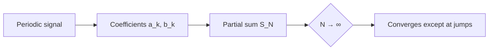

## Idea

A periodic signal can be written as a sum of sines and cosines. For a square wave only the **odd harmonics** remain:

$$
f(t) = \frac{4}{\pi} \sum_{k \text{ odd}} \frac{\sin(k t)}{k}
$$

<Callout type="definition" title="Partial sum">
The partial sum $S_N(t)$ keeps only the harmonics up to $N$. See <Source file="assets/lectures/vl-05.pdf" page={12} />.
</Callout>

<Callout type="exam">
The overshoot near a jump is about 9 % and **does not vanish** when $N \to \infty$ (Gibbs phenomenon).
</Callout>

## Explore

<FunctionPlot
  functions={[
    { expr: "4/pi * (sin(x) + sin(3x)/3 + sin(5x)/5 + sin(7x)/7)", label: "$S_7(t)$" },
    { expr: "a * sign(sin(w * x))", color: "emphasis", dashed: true, label: "square wave" },
  ]}
  params={{ a: { min: 0.5, max: 1.5, value: 1, label: "$a$" }, w: { min: 0.5, max: 2, value: 1, label: "$\\omega$" } }}
  xRange={[-6.5, 6.5]}
  yRange={[-1.8, 1.8]}
/>

## Derivation

<Steps>
  <Step title="Odd function">$f$ is odd, so all $a_k = 0$.</Step>
  <Step title="Coefficients">$b_k = \frac{2}{\pi} \int_0^\pi \sin(kt)\,dt = \frac{2}{k\pi}(1 - \cos k\pi)$</Step>
  <Step title="Result">$b_k = \frac{4}{k\pi}$ for odd $k$, $0$ otherwise.</Step>
</Steps>

## Structure



<Tabs>
  <Tab label="Real form">$f(t) = \frac{a_0}{2} + \sum_k a_k \cos(kt) + b_k \sin(kt)$</Tab>
  <Tab label="Complex form">$f(t) = \sum_{k=-\infty}^{\infty} c_k e^{ikt}$</Tab>
</Tabs>

```python
import numpy as np
def partial_sum(t, n):
    return 4 / np.pi * sum(np.sin(k * t) / k for k in range(1, n + 1, 2))
```

## Spectrum

<Plotly
  data={[{ type: "bar", x: [1, 3, 5, 7, 9, 11], y: [1.273, 0.424, 0.255, 0.182, 0.141, 0.116], name: "|b_k|" }]}
  layout={{ xaxis: { title: { text: "k" } }, yaxis: { title: { text: "|b_k|" } } }}
  height={320}
/>

## Practice

<Quiz
  question="Which harmonics appear in the Fourier series of a square wave?"
  options={[
    { text: "All harmonics $k = 1, 2, 3, \\dots$" },
    { text: "Only odd harmonics", correct: true },
    { text: "Only even harmonics", explain: "Even harmonics vanish by symmetry." },
  ]}
  explanation="The square wave has half-wave symmetry, so $b_k = 0$ for even $k$."
/>

<Flashcards>
  <Flashcard front="What is the Gibbs overshoot?">About 9 % of the jump height, independent of $N$.</Flashcard>
  <Flashcard front="Amplitude of the $k$-th harmonic?">$\frac{4}{k\pi}$ for odd $k$.</Flashcard>
</Flashcards>

<Solution>
Use $\cos(k\pi) = (-1)^k$, so $1 - \cos(k\pi) = 2$ for odd $k$.
</Solution>
